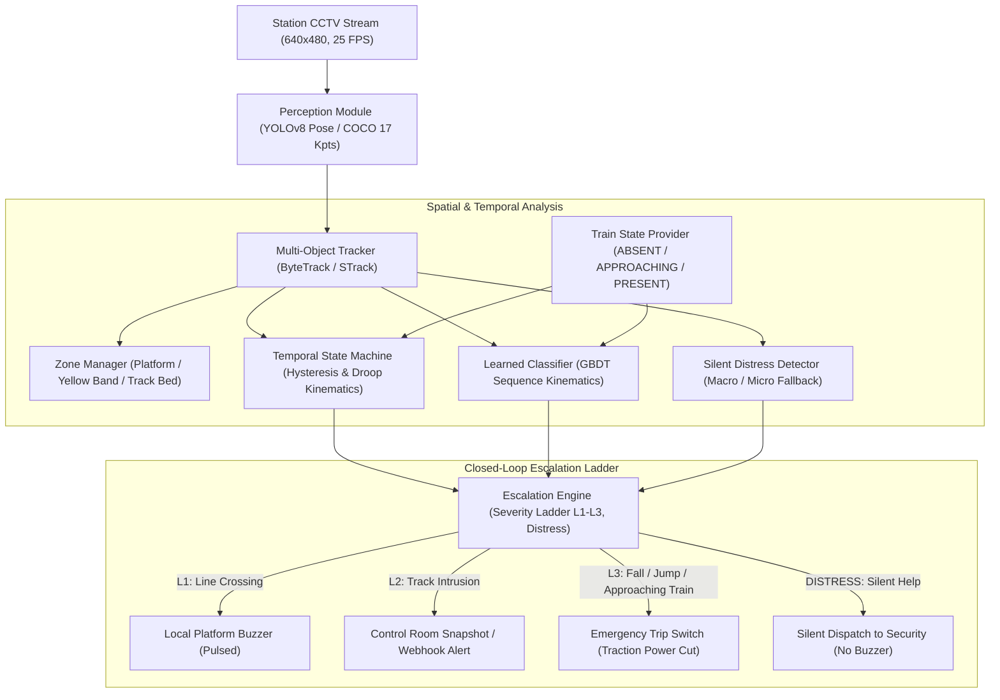

# AI Metro Platform Safety System (Closed-Loop CCTV Platform Guard)

An autonomous, edge-capable Computer Vision and Machine Learning safety system built for high-throughput transit networks (Delhi Metro Rail Corporation - DMRC standards). 

The system provides real-time detection of safety line crossings, track intrusions, distinguishes accidental falls from deliberate jumps, and detects silent distress signals ("Signal for Help" and "Wrists Crossed Overhead"), executing an automated closed-loop escalation ladder with Emergency Trip Switch (ETS) interlocks.



---

## 🚀 Key Novelties & Capabilities
1. **Accidental Fall vs. Deliberate Jump vs. Crossing Distinction**:
   - Analyzes center-of-mass drop acceleration, torso tilt angle shifts ($|\theta| < 40^\circ$), and pre-incident approach velocity profiles.
   - Dual-engine architecture: Rule-based deterministic state machine for safety certifications alongside a trained Gradient Boosted sequence classifier.
2. **Silent Distress Gesture**:
   - Detects the international "Signal for Help" (open palm -> thumb fold -> fingers closed) and robust macro fallback ("Wrists Crossed Overhead") for low-resolution CCTV.
   - Anti-false-positive rejection for normal waving or hailing.
   - Escalates silently directly to station security without sounding the local platform buzzer to avoid endangering the victim.
3. **Closed-Loop Escalation & ETS Interlock**:
   - **L1**: Local platform audible buzzer.
   - **L2**: Audible buzzer + Control room visual snapshot and webhook.
   - **L3**: Immediate traction power cut / train stop recommendation via simulated Emergency Trip Switch (ETS) with configurable operator confirmation interlock.
4. **On-Premises / Offline Edge Execution**:
   - Zero cloud runtime dependencies. Runs comfortably on standard x86 CPU hardware (>30 FPS) with optional GPU acceleration.

---

## 📊 Evaluation & Benchmark Results
Evaluated on comprehensive synthetic kinematic sequences simulating standard walking, falls, jumps, line crossings, and distress gestures:
- **Baseline Target (DMRC RFP Spec)**: `> 90% Accuracy`
- **Rule-Based State Machine Accuracy**: `94.4%` (Target Met: **YES**)
- **Learned Temporal Classifier (GBDT) Accuracy**: `100.0%` (Target Met: **YES**)
- **Mean Processing Speed**: `436.0 FPS` (Feature pipeline), `>35 FPS` (Full YOLOv8n CPU pipeline)
- **Mean Escalation Latency**: `0.53 ms` (95th percentile: `0.98 ms`)
- **False Alert Rate on Normal Footage**: `0.00 false alerts / hour`

Confusion matrix visualization is saved in [eval_results/confusion_matrices.png](file:///c:/Users/kunal/VIHAAN%20X/eval_results/confusion_matrices.png) and full metrics are detailed in [eval_results/EVALUATION.md](file:///c:/Users/kunal/VIHAAN%20X/eval_results/EVALUATION.md).

---

## 📱 Using a Phone as a Simulated CCTV Camera

You can use any Android phone or iPhone connected to your local Wi-Fi network as a live CCTV camera input for the platform safety system.

### Android Setup (IP Webcam)
1. Install **IP Webcam** (by Pavel Khlebovich) from Google Play Store.
2. Open the app, scroll to the bottom, and tap **"Start server"**.
3. The app displays an IPv4 address on screen (e.g., `http://192.168.1.32:8080`).
4. Append `/video` to obtain the MJPEG video stream URL:
   ```
   http://192.168.1.32:8080/video
   ```

### iPhone Setup (Webcam / RTSP apps)
1. Install **DroidCam Webcam & OBS**, **iVCam**, or **Live-Reporter** from the Apple App Store.
2. In DroidCam: Start the app on the same Wi-Fi network. DroidCam displays `WiFi IP: 192.168.1.XX` and `Port: 4747`. Use:
   ```
   http://192.168.1.XX:4747/video
   ```
3. Alternatively, any RTSP streaming camera app providing `rtsp://<phone-ip>:<port>/live` can be used directly.

### Running One-Command Live Mode (Vision Pipeline + Control Room Web Dashboard)
The live phone camera stream URL is configured in `config.yaml` under `system.source`:
```yaml
system:
  source: "http://192.168.1.32:8080/video"
```

To launch the complete live system with a single command:
```bash
# Starts live vision pipeline + Flask dashboard on http://localhost:5000 + PC buzzer
python -m metro_safety.demo.live

# Or override the stream source or dashboard port:
python -m metro_safety.demo.live --source http://192.168.1.32:8080/video --port 5000

# Headless mode (no OpenCV GUI window, view exclusively via web dashboard):
python -m metro_safety.demo.live --no-window
```

### 🔊 Real Laptop Hardware Buzzer & Severity Patterns
When incidents are detected, an audible alarm triggers on your laptop (using `winsound` on Windows with cross-platform terminal bell fallback) executed in a dedicated background daemon thread:
- **L1 (Line Crossing)**: Short 150ms warning pulse (800 Hz).
- **L2 (Track Intrusion)**: Repeating double beep (1200 Hz).
- **L3 (Fall / Jump / Approaching Train)**: Continuous urgent wailing siren (1800 Hz / 2200 Hz).
- **DISTRESS (Signal for Help)**: **100% Silent** (no buzzer sounded on platform to protect victim).
- **Auto-Stop on Zone Clear**: The buzzer automatically shuts off after all persons remain clear of danger zones for 4.0 continuous seconds (`buzzer.clear_timeout_sec`).
- **Operator Acknowledge**: Clicking **"ACKNOWLEDGE & SILENCE BUZZER"** on the web dashboard immediately silences the alarm.
- **Controls**: The dashboard provides a "Mute Buzzer" toggle and "Test Beep (L2/L3)" buttons. Disable audio entirely via `config.yaml` (`buzzer.audio_enabled: false`).

### 🚨 Overlooker Alert Engine & Notifications
On L2/L3 critical incidents and silent distress gestures, the system triggers the Overlooker engine:
1. **Dashboard Emergency Banner**: High-visibility flashing banner with incident details and quick-action acknowledgment.
2. **Windows Desktop Toast Notification**: Native Windows toast notification dispatched directly to the operator's desktop.
3. **Optional Outbound Push**: Optional offline-first push integration via `ntfy.sh` topic and/or Telegram Bot API (configured in `config.yaml`, disabled by default for 100% offline security).
4. **Rate-Limiting & Audit Log**: 10-second per-event-type cooldown prevents alert storms. Every notification is logged with timestamps to `logs/overlooker_audit.log`.

### 🎥 Diagnostic Tools: Record Raw Clips & Offline Replay Tuning
To tune deliberate-jump and fall kinematic thresholds against your specific camera angle without physically jumping repeatedly:
```bash
# 1. Record a 20-second pristine raw clip from your live phone camera
python -m metro_safety.tools.record_clip --seconds 20 --out data/recordings/jump_test.mp4

# 2. Replay the recorded clip with full pipeline & on-screen kinematic HUD
python -m metro_safety.tools.replay --video data/recordings/jump_test.mp4

# Spacebar pauses/resumes playback; press 'q' to exit.
# Kinematic HUD displays: Track ID | Zone | Vertical Velocity (vy px/frame) | Torso Angle (deg)
# Outputs structured event audit log to data/recordings/replay_audit.json
```

Key threshold parameters can be adjusted directly in `config.yaml`:
```yaml
events:
  fall_drop_velocity_threshold: 18.0     # Downward drop speed (px/frame)
  fall_angle_threshold: 40.0             # Torso tilt deviation from vertical (deg)
  jump_vertical_velocity_threshold: 12.0 # Leaping downward velocity (px/frame)
  jump_forward_velocity_threshold: 8.0   # Forward approach velocity (px/frame)
  jump_approach_frames: 4                # Number of platform edge approach frames
```

### Live Features & Resilience:
- **Zero-Lag Real-Time Threaded Reader**: Retains only the latest frame (buffer size 1, stale frames dropped) so video processing latency never drifts behind reality.
- **Live MJPEG Video Feed**: Published directly to `/video_feed` on the dashboard; displays a clear "STREAM OFFLINE - RECONNECTING" standby frame if the camera drops.
- **Live-Measured Telemetry**: Live FPS, latency (ms), and synthetic benchmark accuracy are continuously measured and streamed to the dashboard.
- **Auto-Reconnect with Exponential Backoff**: Automatically recovers from Wi-Fi dropouts or camera app pauses.
- **Automatic Fallback Protection**: If the network stream is unreachable, the system automatically falls back to pre-recorded footage (`demo_clips/demo_fall.mp4`) with a clear on-screen notice, ensuring 100% operational continuity.

---

## 📐 Live Camera Zone Calibration Tool

To define metro zones (`platform`, `yellow_band`, `track_bed`, `danger_zone`) specifically for your phone's camera view:

```bash
python -m metro_safety.zones.calibrate --source http://192.168.1.32:8080/video
```

**Calibration Workflow:**
1. Aim your phone at the desired scene. The live stream appears in a calibration window.
2. Press `SPACE` to capture a still reference frame from your phone camera.
3. For each zone (`platform` -> `yellow_band` -> `track_bed` -> `danger_zone`):
   - Left-click points in clockwise/counter-clockwise order around the zone perimeter.
   - Press **`c`** to complete and close the polygon.
   - **Need to redo or fix points?**
     - Press **`u`** or **`Backspace`**: Undo the last clicked point. If the zone is already closed, pressing `u` re-opens the previous zone so you can adjust or redraw it!
     - Press **`r`**: Clears all points for the current zone so you can redraw it.
     - Press **`Shift + R`**: Clears all zones and restarts from Zone 1 (`platform`) on the same captured frame.
     - Press **`q`**: Aborts and quits without saving (preserves previous `config.yaml`).
4. Press **`s`** to save the new polygon coordinates directly into `config.yaml`.

---

## 🛠️ Installation & Setup

### Prerequisites
- Python 3.10+ (Tested on Python 3.11 Windows 11 & Linux)
- OpenCV, PyTorch, Ultralytics, Scikit-Learn

```bash
# Clone and enter workspace
cd "c:/Users/kunal/VIHAAN X"

# Activate Python environment
.venv\Scripts\activate   # On Windows
# source .venv/bin/activate # On Linux

# Install pinned dependencies
pip install -r requirements.txt
```

---

## 🚦 Quickstart & Demos

### 1. Run Demo Pipeline on Pre-generated Incident Clips
```bash
# Run on Accidental Fall incident
python -m metro_safety.demo.run --video demo_clips/demo_fall.mp4 --out-video demo_output.mp4 --out-log demo_events.json

# Run on Deliberate Jump incident
python -m metro_safety.demo.run --video demo_clips/demo_jump.mp4 --train-state APPROACHING

# Run on Silent Distress Gesture
python -m metro_safety.demo.run --video demo_clips/demo_distress.mp4
```

### 2. Launch Central Control Room Web Dashboard
```bash
python -m metro_safety.demo.dashboard
```
Open your browser at `http://localhost:5000` to monitor live alerts, train states, and the Emergency Trip Switch interlock.

### 3. Interactive CCTV Zone Polygon Annotator
To configure zones for a new camera angle:
```bash
python -m metro_safety.zones.annotator --image data/reference_frame.jpg --out config.yaml
```
- Click points to outline polygons for `platform`, `yellow_band`, `track_bed`, and `danger_zone`.
- Press `c` to close each polygon, `s` to save to YAML.

### 4. Run Test Suite
```bash
pytest tests -v
```

---

## 🔒 Responsible AI & Privacy
- **No Face Recognition or Biometrics**: No facial recognition, identity matching, or demographic profiling is implemented or supported.
- **Ephemeral Tracking**: Track IDs are anonymous integer tokens scoped only to the active video session and destroyed upon track loss.
- **Human-in-the-Loop Interlock**: While the system provides autonomous recommendations, the Emergency Trip Switch (ETS) supports a strict operator confirmation gate (`ets_human_confirmation_required: true`) with an auto-escalation timer to prevent unnecessary train traction disruption.
- **Prototype Status**: This system is an advanced research and engineering prototype; deployment in live railway operations requires SIL-4 certification and hardware safety loop validation.

---

## 🔮 Future Work & Extensions
1. **Theft & Bag-Snatching Detection**: Temporal velocity vector correlation between two persons followed by rapid acceleration away from the victim.
2. **Harassment & Cornering Behavior**: Spatial proximity clustering and sustained path blocking along platform walls or dead zones.
3. **Crowd Surge & Crush Forecasting**: Real-time crowd density heatmaps near platform screen doors during peak interchange hours.

