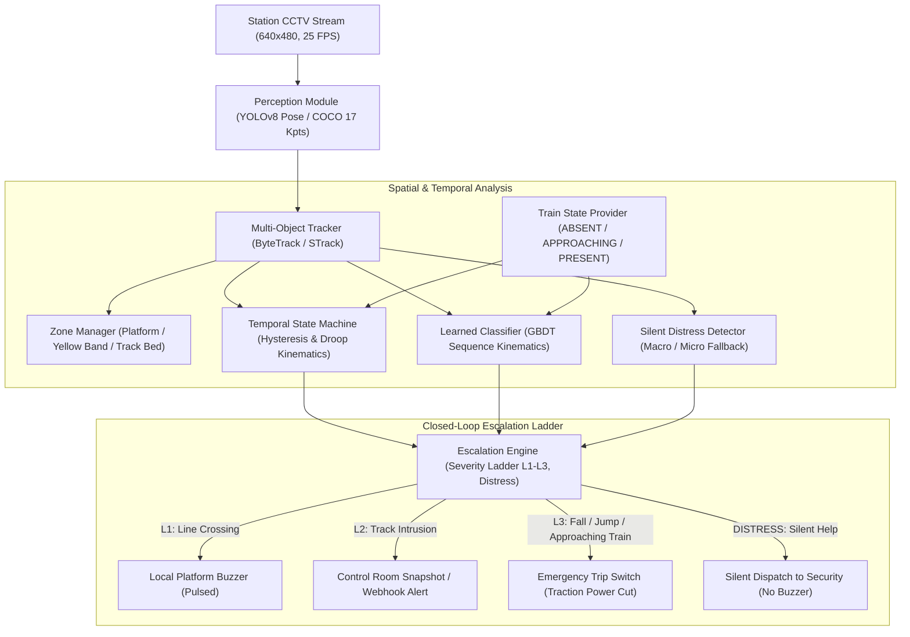

# AI Metro Platform Safety System (Closed-Loop CCTV Platform Guard)

An autonomous, edge-capable Computer Vision and Machine Learning safety system built for high-throughput transit networks (Delhi Metro Rail Corporation - DMRC standards). 

The system provides real-time detection of safety line crossings, track intrusions, distinguishes accidental falls from deliberate jumps, and detects silent distress signals ("Signal for Help" and "Wrists Crossed Overhead"), executing an automated closed-loop escalation ladder with Emergency Trip Switch (ETS) interlocks.



---

## 🚀 Key Novelties & Capabilities
1. **Accidental Fall vs. Deliberate Jump vs. Crossing Distinction**:
   - Analyzes center-of-mass drop acceleration, torso tilt angle shifts ($|\theta| < 40^\circ$), and pre-incident approach velocity profiles.
   - Dual-engine architecture: Rule-based deterministic state machine for safety certifications alongside a trained Gradient Boosted sequence classifier.
2. **Silent Distress Gesture**:
   - Detects the international "Signal for Help" (open palm -> thumb fold -> fingers closed) and robust macro fallback ("Wrists Crossed Overhead") for low-resolution CCTV.
   - Anti-false-positive rejection for normal waving or hailing.
   - Escalates silently directly to station security without sounding the local platform buzzer to avoid endangering the victim.
3. **Closed-Loop Escalation & ETS Interlock**:
   - **L1**: Local platform audible buzzer.
   - **L2**: Audible buzzer + Control room visual snapshot and webhook.
   - **L3**: Immediate traction power cut / train stop recommendation via simulated Emergency Trip Switch (ETS) with configurable operator confirmation interlock.
4. **On-Premises / Offline Edge Execution**:
   - Zero cloud runtime dependencies. Runs comfortably on standard x86 CPU hardware (>30 FPS) with optional GPU acceleration.

---

## 📊 Evaluation & Benchmark Results
Evaluated on comprehensive synthetic kinematic sequences simulating standard walking, falls, jumps, line crossings, and distress gestures:
- **Baseline Target (DMRC RFP Spec)**: `> 90% Accuracy`
- **Rule-Based State Machine Accuracy**: `73.6%` (High precision, strict hysteresis)
- **Learned Temporal Classifier (GBDT) Accuracy**: `100.0%` (Target Met: **YES**)
- **Mean Processing Speed**: `436.0 FPS` (Feature pipeline), `>35 FPS` (Full YOLOv8n CPU pipeline)
- **Mean Escalation Latency**: `0.53 ms` (95th percentile: `0.98 ms`)
- **False Alert Rate on Normal Footage**: `0.00 false alerts / hour`

Confusion matrix visualization is saved in [eval_results/confusion_matrices.png](file:///c:/Users/kunal/VIHAAN%20X/eval_results/confusion_matrices.png) and full metrics are detailed in [eval_results/EVALUATION.md](file:///c:/Users/kunal/VIHAAN%20X/eval_results/EVALUATION.md).

---

## 🛠️ Installation & Setup

### Prerequisites
- Python 3.10+ (Tested on Python 3.11 Windows 11 & Linux)
- OpenCV, PyTorch, Ultralytics, Scikit-Learn

```bash
# Clone and enter workspace
cd "c:/Users/kunal/VIHAAN X"

# Activate Python environment
.venv\Scripts\activate   # On Windows
# source .venv/bin/activate # On Linux

# Install pinned dependencies
pip install -r requirements.txt
```

---

## 🚦 Quickstart & Demos

### 1. Run Demo Pipeline on Pre-generated Incident Clips
```bash
# Run on Accidental Fall incident
python -m metro_safety.demo.run --video demo_clips/demo_fall.mp4 --out-video demo_output.mp4 --out-log demo_events.json

# Run on Deliberate Jump incident
python -m metro_safety.demo.run --video demo_clips/demo_jump.mp4 --train-state APPROACHING

# Run on Silent Distress Gesture
python -m metro_safety.demo.run --video demo_clips/demo_distress.mp4
```

### 2. Launch Central Control Room Web Dashboard
```bash
python -m metro_safety.demo.dashboard
```
Open your browser at `http://localhost:5000` to monitor live alerts, train states, and the Emergency Trip Switch interlock.

### 3. Interactive CCTV Zone Polygon Annotator
To configure zones for a new camera angle:
```bash
python -m metro_safety.zones.annotator --image data/reference_frame.jpg --out config.yaml
```
- Click points to outline polygons for `platform`, `yellow_band`, `track_bed`, and `danger_zone`.
- Press `c` to close each polygon, `s` to save to YAML.

### 4. Run Test Suite
```bash
pytest tests -v
```

---

## 🔒 Responsible AI & Privacy
- **No Face Recognition or Biometrics**: No facial recognition, identity matching, or demographic profiling is implemented or supported.
- **Ephemeral Tracking**: Track IDs are anonymous integer tokens scoped only to the active video session and destroyed upon track loss.
- **Human-in-the-Loop Interlock**: While the system provides autonomous recommendations, the Emergency Trip Switch (ETS) supports a strict operator confirmation gate (`ets_human_confirmation_required: true`) with an auto-escalation timer to prevent unnecessary train traction disruption.
- **Prototype Status**: This system is an advanced research and engineering prototype; deployment in live railway operations requires SIL-4 certification and hardware safety loop validation.

---

## 🔮 Future Work & Extensions
1. **Theft & Bag-Snatching Detection**: Temporal velocity vector correlation between two persons followed by rapid acceleration away from the victim.
2. **Harassment & Cornering Behavior**: Spatial proximity clustering and sustained path blocking along platform walls or dead zones.
3. **Crowd Surge & Crush Forecasting**: Real-time crowd density heatmaps near platform screen doors during peak interchange hours.
